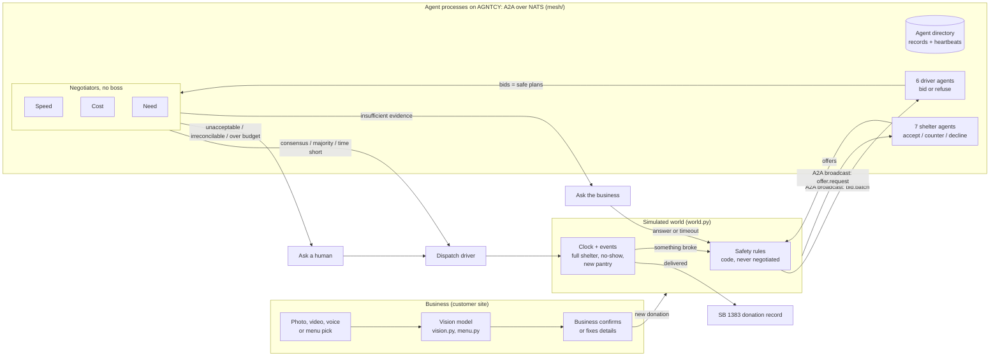

# Architecture and technical details

## Overview

The agents are real; the world around them is simulated. A business photo becomes food details, safety code removes every unsafe option, and agents with competing goals negotiate what's left. **Every agent runs as its own process and is an AGNTCY A2A agent over NATS** (Cisco's open agent stack): the agents find each other through an agent directory and exchange A2A messages, one broadcast per step. Every decision, objection, veto, fallback and message is shown live on the dashboard.

## The pieces

| Piece | File | Notes |
| --- | --- | --- |
| Customer site | `static/app.*` | For businesses: schedule a pickup by photo, video, voice or menu pick; track it; download receipts. No agent jargon. |
| Ops dashboard | `static/dashboard.*` | For judges: live agent-network diagram, the debate, the Phone line, map, Decisions inbox, Activity (incl. Agent services), Evidence, How it works. Polls `/api/state` every second. |
| Shelter phone | `static/shelter.html` | A person answers for a shelter: accept, take part, or decline, by tap or voice. |
| Vision and menus | `vision.py`, `menu.py`, `llm.py` | The model names and counts the food (a range and a confidence); code turns counts into servings, weight and safe time, and matches items to the business's menu. Claude via the official SDK; an open model on an NVIDIA Brev GPU as backup. |
| Safety rules | `world.py` `block_reason`, `safe_plans` | Food type, fridge, allergens (unconfirmed count as present), capacity incl. food on its way, opening hours, arrival at least 5 minutes before unsafe. Agents never see a plan that fails these. |
| Shelter and driver agents | `network.py` | Each shelter answers from its own situation (accept, counter-offer, decline); each driver bids or refuses a trip beyond its range. |
| Negotiators | `agents.py` | Speed, Cost and Need each evaluate every plan, propose, vote, and hold one red line. Each step is a separate function (`agent_evaluate`, `agent_propose`, `agent_vote`) so it can run in its own process. Rules by default; `LLM_AGENTS=1` lets Claude reason. |
| Agent processes | `mesh/` | Directory, one process per agent (A2A over NATS with the AGNTCY app-sdk, HTTP fallback), the client that broadcasts and traces every message, the launcher (also starts `nats-server`). See "Distributed runtime" below. |
| In-app AGNTCY bridge | `agntcy_bridge.py` | Used only when the separate processes are off (`MESH=0 AGNTCY=1`): serves shelter and driver agents over AGNTCY inside the app, and publishes OASF records at `/agntcy/records`. |
| Voices | `voice.py` | ElevenLabs: agents speak the debate; the Phone line; shelters hear requests and answer by voice (Scribe). |
| Server | `app.py` | Flask. A clock thread and a planner thread; negotiations run outside the lock so a slow agent never freezes the dashboard. |
| Scenarios and evidence | `scenarios.py` | 9 scripted scenarios and a seeded random generator, run against 5 policies. See [RESULTS.md](RESULTS.md). |

## Distributed runtime (the agent processes)

| Part | How it works |
| --- | --- |
| One process per agent | `python app.py` starts about 16: 7 shelters, 6 drivers, Speed, Cost and Need. A pantry or driver that joins mid-run gets its own. They exit when the app exits, even after a crash. |
| AGNTCY A2A over NATS | Each process serves an A2A AgentCard (`uplink/shelters/<id>`, `uplink/drivers/<id>`, `uplink/negotiators/<name>`) with the AGNTCY app-sdk. The negotiation table uses the SDK's A2A client: one `broadcast_message` per step. |
| Messages | `offer.request` to every shelter; `bid.batch` to every driver (each answers only its own trips); `plan.evaluate`, then `plan.propose` and `plan.vote` per round, to the three negotiators. Each carries the facts the agent needs (`mesh/view.py`), so an agent in another process decides exactly as it would in-process. |
| Agent directory | Records modeled on AGNTCY's Agent Directory and OASF (id, skills, capabilities, A2A card name, protocols). Agents heartbeat every 2 s and drop out after 6 s of silence. |
| Failure handling | A shelter or driver that doesn't answer isn't consulted. A negotiator that doesn't answer is stood in for by the same logic, logged. A failed broadcast falls back to HTTP for that step. |
| Proof | `tests/test_mesh.py`: identical results to in-process in all 9 scenarios, over A2A/NATS and over HTTP. |
| Switches | `AGNTCY=0`: agent processes on HTTP. `MESH=0`: everything in one process. |

## Negotiation protocol

No agent has the final say, and no supervisor picks the winner. Shared code only counts the votes.

1. **Safety first.** Every (shelter, driver) plan that breaks a safety rule is removed and logged with its reason.
2. **Evidence check.** If the food's allergens are unconfirmed and some agent's best plan is ruled out *only* because of that, and there are 45+ minutes left, the agents agree to stop and ask the business. They wait up to 15 minutes (never past 30 minutes before unsafe), then act on what they know: unconfirmed allergens are treated as present.
3. **Up to 3 rounds.** Each round:
   - Every agent **proposes** one plan. Round 1 is its favourite. Later rounds weigh the least-happy other agent more (concession 0 → 0.45 → 0.75) and avoid plans another agent vetoed.
   - Every agent **votes** on every plan on the table. It accepts if the plan scores at least 90% / 78% / 65% (round 1 / 2 / 3) of its best option, unless the plan crosses its **red line**, which is a veto in every round.
   - Objections carry reasons and a kind (time, cost, need, reliability, veto) that the feed shows.
4. **Ending.**

| Outcome | Rule |
| --- | --- |
| Consensus | Some plan has all three votes. Ties go to the best combined score. |
| Time is short | Food has under 30 minutes left and there's no consensus: act on the plan nobody vetoed with the most support, ties to the best combined score. |
| Majority | After round 3, a plan has ≥ 2.0 vote weight and no veto. The losing objection is kept on record. |
| Unacceptable compromise | After round 3, the only majority plans are vetoed by the third agent. Ask a human with the reason and the top two options. |
| Irreconcilable | After round 3, no plan has majority support. Ask a human. |
| Over budget | The winning plan costs more than $25. Ask a human. |

**Red lines:**

| Agent | Goal (score) | Red line (veto) |
| --- | --- | --- |
| Speed | Minutes to spare ÷ minutes left, weighted by driver reliability | Under 10 minutes to spare, or a driver under 50% reliable |
| Cost | Cheaper is better, weighted by reliability (a no-show means paying for a rescue) | Over $20 for one donation |
| Need | Days since the shelter's last donation (70%) and room left (30%) | Feeding a shelter that got food today while another reachable shelter has waited 4+ days |

**Adaptation.** When a driver cancels, their reliability drops 30 points and every agent's scores see it. Any agent that objected to or vetoed that driver for reliability gains +0.25 vote weight for the rest of the run, so its future objections count for more.

**LLM mode.** With `LLM_AGENTS=1`, each agent's proposal and votes come from the model, given its goal, its red line, the candidate plans with its own score, and the earlier rounds. Red lines are still enforced in code, and any failed call falls back to the rules for that agent.

## Fallback rules (disclosed)

These are not decision-makers; they exist so the food doesn't spoil while nobody answers.

- **Scripted runs** have nobody at the keyboard, so when the agents ask a human, a simulated coordinator picks the agents' top-ranked option. The feed says so.
- **Live demo:** if nobody answers an escalation, the agents act at the last moment an option can still arrive safely (shown on the card as "Decide by HH:MM"), using their best-ranked option that still makes it. Labeled "Fallback rule" in the feed and counted on the dashboard.
- **Any approval is re-checked:** an option that would now arrive too late isn't dispatched; the agents find one that still works.

## Baselines

| Policy | What it does |
| --- | --- |
| Nearest shelter | Closest shelter that takes this food type, closest free driver. No fridge, hours, allergen, capacity or timer checks. The simple approach to beat. |
| Speed alone / Cost alone / Need alone | Same safety rules as the team, but one agent decides by itself: it takes its own top-scoring plan with no negotiation, no red lines and no questions. This answers "can the agents decide better together than individually?" |
| Agents together | The full protocol above. |

## Scenarios

| Scenario | What it tests |
| --- | --- |
| Lunch rush | Four donations, a full shelter, a volunteer no-show |
| Volunteer no-show | Two volunteers cancel on short-lived hot food |
| Standoff | Every safe option is expensive, so the agents ask a coordinator |
| City mode | 18 donations across Santa Clara in 45 minutes; drivers and a pantry join mid-run |
| New pantry | New information: a pantry joins the directory mid-run |
| Majority with dissent | Cost is outvoted on a paid courier; its objection is kept on record |
| Unacceptable compromise | Two agents want a plan that crosses the third's red line |
| Irreconcilable goals | No plan wins a majority, so a human decides |
| Insufficient evidence | The agents ask a business about allergens; one answers, one doesn't |

Scenarios can set the start time, take drivers offline, and override shelter or driver fields (e.g. surge pricing), so each conflict is reproducible. `scenarios.random_scenario(seed)` generates seeded random runs (3–6 donations, no-shows, full shelters, new pantries) for the evidence in [RESULTS.md](RESULTS.md).

## API

| Endpoint | Purpose |
| --- | --- |
| `GET /api/state` | Everything the dashboard draws |
| `POST /api/reset` | Start a scenario (`{"scenario": name}`) or an empty world |
| `POST /api/control` | Speed and pause |
| `POST /api/vision` | Photo or video frames → food details |
| `GET/POST /api/menu/<business>` | The business's menu; add an item |
| `POST /api/donate`, `/api/donate/menu`, `/api/voice/donation` | A confirmed donation: from the form, from menu picks, or spoken |
| `POST /api/event/<decline\|cancel\|new_pantry>` | Problem buttons |
| `POST /api/approve` | A human picks one of the agents' options |
| `POST /api/confirm` | The business answers the agents' question (`allergens: [...]`, or `null` for "can't say") |
| `GET /api/compare` | Scripted scenarios plus seeded random runs under every policy (cached) |
| `GET /api/shelter/<id>`, `POST /api/shelter/respond`, `POST /api/shelter/voice` | The shelter phone: its requests, and answers by tap or voice |
| `GET /api/tts`, `GET /api/shelter/<id>/ask_text` | ElevenLabs speech for the debate and the Phone line |
| `GET/POST /api/closing`, `POST /api/camera/status` | The business camera |
| `GET /api/mesh`, `POST /api/mesh/<stop\|start>` | Agent processes: directory listing, message trace; stop or restart one |
| `GET /agntcy/records`, `GET /agntcy/cards` | Every agent's OASF record and A2A AgentCard |
