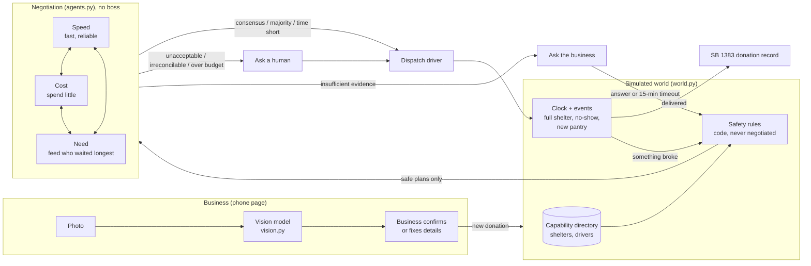

# Architecture and technical details

## Overview

The agents are real; the world around them is simulated. A business photo becomes food details, safety code removes every unsafe option, and three agents with competing goals negotiate what's left. Every decision, objection, veto and fallback is written to a feed the dashboard shows live.

## The pieces

| Piece | File | Notes |
| --- | --- | --- |
| Vision | `vision.py`, `llm.py` | One cloud model call returns items, servings, weight range, allergens, category, cold-chain need, safe time, and whether allergens are uncertain. With no API key it returns a demo result. |
| Business page | `static/business.html` | Phone-sized. The business fixes any wrong guess before confirming ("20 sandwiches, not 40") and can tick "Not sure about allergens". |
| Directory | `world.py` `search_directory` | Shelters register capabilities (food types, fridge, hours, capacity, allergens they must avoid). A new pantry can join mid-run. |
| Safety rules | `world.py` `block_reason`, `safe_plans` | Food type, fridge, allergens (unconfirmed allergens count as present), capacity including food already on its way, opening hours, arrival at least 5 minutes before unsafe. Agents never see a plan that fails these. |
| Agents | `agents.py` | Speed, Cost and Need each score every plan against their own goal and have one red line. Rules mode by default; `LLM_AGENTS=1` lets the model propose, vote and explain. |
| Clock and events | `world.py` `tick` | 1 tick = 1 simulated minute (1 real second at 1× in the live demo). Drivers move along straight lines. |
| Server | `app.py` | Flask. A clock thread and a planner thread; negotiations run outside the lock so a slow model call doesn't freeze the dashboard. |
| Dashboard | `static/dashboard.html` | Leaflet map, negotiation panel (step through rounds), feed, safety decision log, human / business question boxes, impact counters, comparison table. Polls `/api/state` every second. |
| Scenarios and evidence | `scenarios.py` | 7 scripted scenarios run against 5 policies. |

## Negotiation protocol

No agent has the final say, and no supervisor picks the winner. Shared code only counts the votes.

1. **Safety first.** Every (shelter, driver) plan that breaks a safety rule is removed and logged with its reason.
2. **Evidence check.** If the food's allergens are unconfirmed and some agent's best plan is ruled out *only* because of that, and there are 45+ minutes left, the agents agree to stop and ask the business. They wait up to 15 minutes (never past 30 minutes before unsafe), then act on what they know: unconfirmed allergens are treated as present.
3. **Up to 3 rounds.** Each round:
   - Every agent **proposes** one plan. Round 1 is its favourite. Later rounds weigh the least-happy other agent more (concession 0 → 0.45 → 0.75) and avoid plans another agent vetoed.
   - Every agent **votes** on every plan on the table. It accepts if the plan scores at least 90% / 78% / 65% (round 1 / 2 / 3) of its best option, unless the plan crosses its **red line**, which is a veto in every round.
   - Objections carry reasons and a kind (time, cost, need, reliability, veto) that the feed shows.
4. **Ending.**

| Outcome | Rule |
| --- | --- |
| Consensus | Some plan has all three votes. Ties go to the best combined score. |
| Time is short | Food has under 30 minutes left and there's no consensus: act on the plan nobody vetoed with the most support, ties to the best combined score. |
| Majority | After round 3, a plan has ≥ 2.0 vote weight and no veto. The losing objection is kept on record. |
| Unacceptable compromise | After round 3, the only majority plans are vetoed by the third agent. Ask a human with the reason and the top two options. |
| Irreconcilable | After round 3, no plan has majority support. Ask a human. |
| Over budget | The winning plan costs more than $25. Ask a human. |

**Red lines:**

| Agent | Goal (score) | Red line (veto) |
| --- | --- | --- |
| Speed | Minutes to spare ÷ minutes left, weighted by driver reliability | Under 10 minutes to spare, or a driver under 50% reliable |
| Cost | Cheaper is better, weighted by reliability (a no-show means paying for a rescue) | Over $20 for one donation |
| Need | Days since the shelter's last donation (70%) and room left (30%) | Feeding a shelter that got food today while another reachable shelter has waited 4+ days |

**Adaptation.** When a driver cancels, their reliability drops 30 points and every agent's scores see it. Any agent that objected to or vetoed that driver for reliability gains +0.25 vote weight for the rest of the run, so its future objections count for more.

**LLM mode.** With `LLM_AGENTS=1`, each agent's proposal and votes come from the model, given its goal, its red line, the candidate plans with its own score, and the earlier rounds. Red lines are still enforced in code, and any failed call falls back to the rules for that agent.

## Fallback rules (disclosed)

These are not decision-makers; they exist so the food doesn't spoil while nobody answers.

- **Scripted runs** have nobody at the keyboard, so when the agents ask a human, a simulated coordinator picks the agents' top-ranked option. The feed says so.
- **Live demo:** if nobody answers an escalation before the food has 15 minutes left, the agents' top-ranked option goes, labeled "Fallback rule" in the feed and counted on the dashboard.

## Baselines

| Policy | What it does |
| --- | --- |
| Nearest shelter | Closest shelter that takes this food type, closest free driver. No fridge, hours, allergen, capacity or timer checks. The simple approach to beat. |
| Speed alone / Cost alone / Need alone | Same safety rules as the team, but one agent decides by itself: it takes its own top-scoring plan with no negotiation, no red lines and no questions. This answers "can the agents decide better together than individually?" |
| Agents together | The full protocol above. |

## Scenarios

| Scenario | What it tests |
| --- | --- |
| Lunch rush | Four donations, a full shelter, a volunteer no-show |
| Volunteer no-show | Two volunteers cancel on short-lived hot food |
| New pantry | New information: a pantry joins the directory mid-run |
| Majority with dissent | Cost is outvoted on a paid courier; its objection is kept on record |
| Unacceptable compromise | Two agents want a plan that crosses the third's red line |
| Irreconcilable goals | No plan wins a majority, so a human decides |
| Insufficient evidence | The agents ask a business about allergens; one answers, one doesn't |

Scenarios can set the start time, take drivers offline, and override shelter or driver fields (e.g. surge pricing), so each conflict is reproducible.

## API

| Endpoint | Purpose |
| --- | --- |
| `GET /api/state` | Everything the dashboard draws |
| `POST /api/reset` | Start a scenario (`{"scenario": name}`) or an empty world |
| `POST /api/control` | Speed and pause |
| `POST /api/vision` | Photo → food details |
| `POST /api/donate` | Confirmed donation from the business page |
| `POST /api/event/<decline\|cancel\|new_pantry>` | Problem buttons |
| `POST /api/approve` | A human picks one of the agents' options |
| `POST /api/confirm` | The business answers the agents' question (`allergens: [...]`, or `null` for "can't say") |
| `GET /api/compare` | Runs every scenario under every policy |
